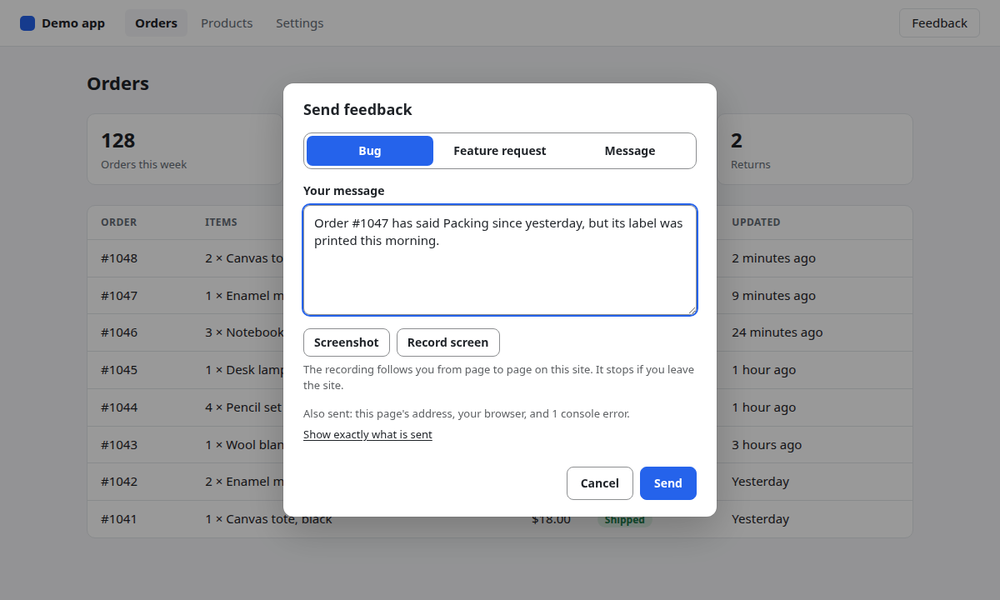
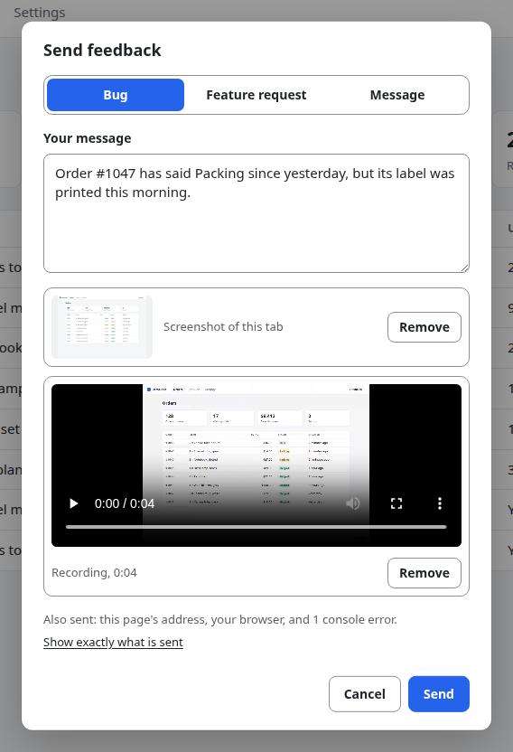
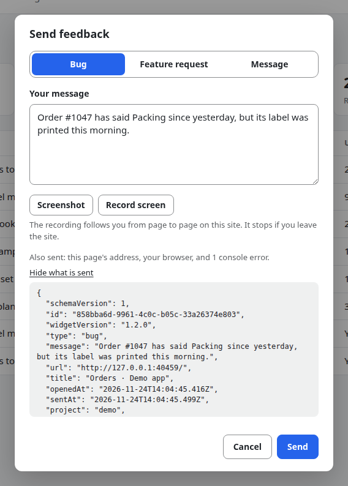
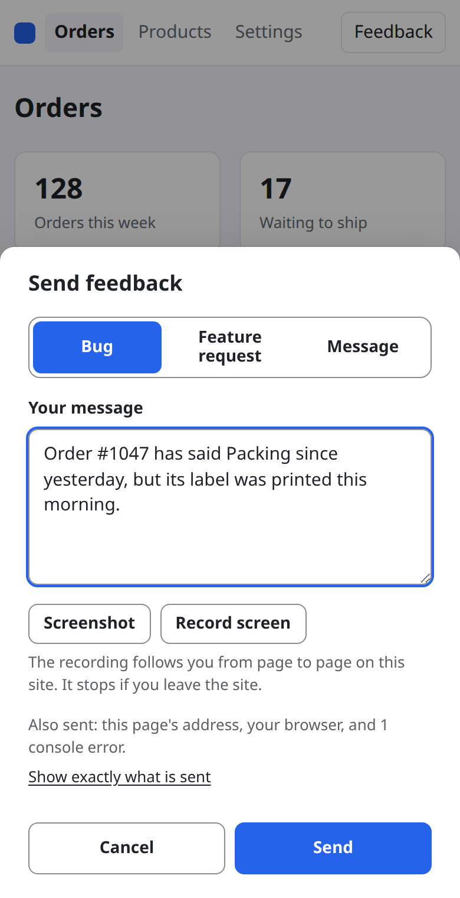
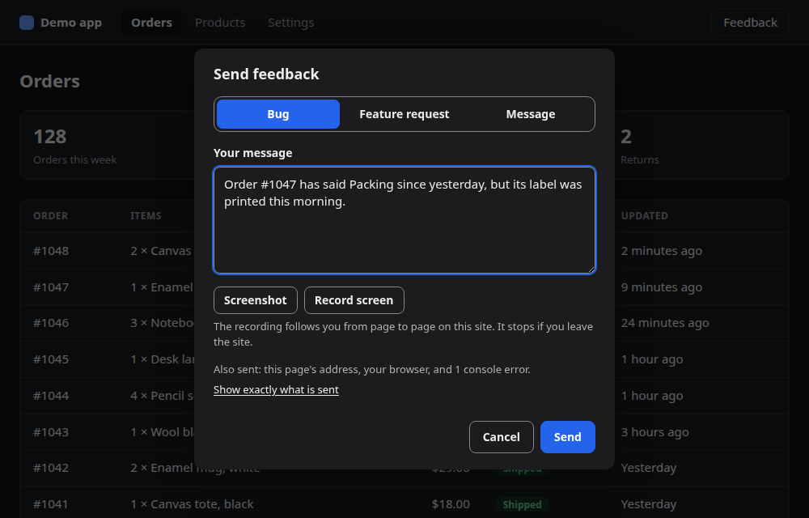
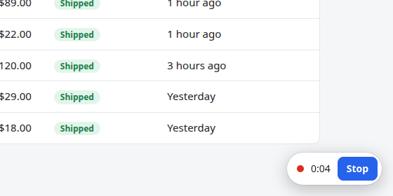

# Feedback

A Feedback button for any website: a person picks Bug, Feature request or Message, types, can
attach a screenshot or a screen recording of the page, and the report is posted to your own
backend with the page's address, the browser's details and the console errors the page had thrown.



## Why

Most in-page feedback and session-replay tools do not capture the screen. They serialize the
page's DOM and replay or re-render it later, or redraw the page onto a canvas and call that a
screenshot. That is a reconstruction. It can differ from what the person saw (canvas and video
content, cross-origin frames and images, fonts, the browser's own controls, a layout that breaks
only in that browser), and it means sending the page's HTML to someone.

This widget asks the browser for the pixels: `getDisplayMedia` for one frame (the screenshot) or
for a stream recorded with `MediaRecorder` (the recording). What arrives is what was on the
screen, as an ordinary image file and an ordinary video file that play anywhere, and the page's
HTML is never sent.

What that costs:

- The browser asks the person's permission at every capture.
- It needs a browser with screen capture: desktop Chrome, Edge and Firefox (this tab only in
  Chrome and Edge, a window or the whole screen in Firefox), and not mobile browsers. Without it
  a report is the message and the errors.
- A capture belongs to the page that started it, so the widget has its own way of
  [keeping a recording going across pages](docs/recording.md#recording-across-pages).

The second reason: nothing goes to a third party and nothing loads until the button is pressed.
The report goes to your own backend.

## What it does

- **Real screenshots and recordings.** An image file and a WebM or MP4 video of the tab, shown to
  the person before they send. On a multi-page site a recording keeps going when they follow a
  link to the next page (Chrome and Edge).
- **Yours end to end.** Two plain JavaScript files you host yourself, no dependencies, no build
  step. The report is one HTTP request to your endpoint.
- **Nothing loaded until pressed.** Every page loads a stub of about 4 KB gzipped that keeps the
  recent console errors and waits for a click. The panel is fetched on the first press.
- **The person sees what is sent.** The panel names what goes with the message and expands to
  the exact report. Tokens, passwords and card numbers in URLs and error text are scrubbed first.
- **A documented protocol.** Any backend can receive reports: there is a written contract,
  example receivers in PHP and Node, and a command-line tool that checks yours against it.

<table>
<tr>
<td width="36%"></td>
<td width="36%"></td>
<td></td>
</tr>
<tr>
<td>A screenshot and a recording attached</td>
<td>The exact report, before it is sent</td>
<td>A bottom sheet on a phone</td>
</tr>
<tr>
<td colspan="2"></td>
<td></td>
</tr>
<tr>
<td colspan="2">The dark theme, which follows the system by default</td>
<td>While recording, the panel is a pill and the page is usable</td>
</tr>
</table>

## Try it

With Node 18 or later and nothing to install:

```sh
git clone https://github.com/carl689/feedback.git
cd feedback
FEEDBACK_DIR=/tmp/feedback-reports node examples/demo.js
```

Open <http://127.0.0.1:8000/>, press **Feedback** and send a report. It is stored as
`/tmp/feedback-reports/<id>.json`, with the screenshot and recording beside it. The page is
[`examples/demo.html`](examples/demo.html) and the backend is the example Node receiver,
[`examples/receiver.js`](examples/receiver.js).

## Install

1. Copy `feedback.js` and `feedbackPanel.js` into your static files, side by side, and serve
   them from your own origin.

2. Load the stub on every page, and mark the element that opens the panel:

   ```html
   <script src="/static/feedback.js" data-endpoint="/api/feedback" defer></script>

   <button type="button" data-feedback>Feedback</button>
   ```

   Any element matching `[data-feedback]` opens the panel. With no button of your own, add
   `data-launcher="true"` to the script tag and the widget draws a floating one.

3. Receive the report at the endpoint. Start from [`examples/receiver.php`](examples/receiver.php)
   or [`examples/receiver.js`](examples/receiver.js) (one file each, no dependencies; read
   [what they leave out](examples/README.md#what-they-leave-out) before either faces the
   internet), or write your own from [the protocol](docs/protocol.md).

Without an `endpoint` the widget is off: one console warning, and nothing is drawn or kept.

## Settings

Settings go on the script tag as `data-` attributes, or in one call from a script of your own:

```html
<script src="/static/feedback.js" defer></script>
<script type="module">
  feedback.init({
    endpoint: '/api/feedback',
    project: 'store',
    release: '4f2a9c1',
    user: {id: 1042, name: 'Ada Lovelace'},
    launcher: {position: 'bottom-right', label: 'Feedback'}
  });
</script>
```

The script that calls `init()` must run after the deferred stub: a module script, a later
deferred script or a `DOMContentLoaded` listener, not a plain inline script.

The settings most sites touch:

| Setting | Default | What it does |
|---|---|---|
| `endpoint` | none, required | Where the report is posted: a path on the page's origin, or an absolute `https:` address (another origin only through `init()`). |
| `project`, `environment`, `release` | `''` | Sent with every report, so you know which site, stage and version it came from. |
| `user` | `null` | `{id, name}` of whoever the page thinks is signed in. A claim by the page: the receiver takes identity from its own session. |
| `context` | `{}` | Any other JSON you want on the report. |
| `launcher` | `false` | `true` or `{position, label}` draws a floating button. |
| `types` | `['bug', 'feature', 'message']` | The type buttons. |
| `theme` | `'auto'` | `'light'`, `'dark'`, or follow the system. |
| `screenshot`, `video` | `true` | `false` removes that button. `video` also takes `{maxSeconds, frameRate, maxWidth, …}`; a recording stops at 60 seconds by default. |
| `fields`, `headers` | `{}` | Extra form fields and request headers, such as a CSRF token. |
| `scrubParams`, `scrubPatterns` | `[]` | Parameter names and patterns to scrub, added to the built-in ones. |
| `beforeSend` | none | A function given the report before it goes: change it, or return `false` to cancel. |

`window.feedback` also has `open()`, `close()`, `setContext({user, context})` for a page that
learns who signed in after loading, and `reset()`, to call when a person signs out.

Every setting, the data-attribute form of each, and the API: [docs/settings.md](docs/settings.md).
Every word the widget shows can be replaced, and six CSS custom properties (such as
`--feedback-accent`) set its colors, corners and font:
[docs/appearance.md](docs/appearance.md).

## Writing a receiver

A report is one `multipart/form-data` POST: a `report` field holding a JSON document, and
optionally a `screenshot` and a `video` file. Answer with any 2xx to accept it, or with a status
and a small JSON error that the widget turns into the right message for the person (sign in
again, too large, try later). [docs/protocol.md](docs/protocol.md) is the whole contract,
including what a receiver must do to be safe: take identity from its own session, store a report
`id` once, and treat every string and file as untrusted.

Check a receiver against the protocol before a page uses it:

```sh
node tests/conformance.js https://your.site/api/feedback
```

## Browser support

- The widget runs in Chrome and Edge 111+, Firefox 113+ and Safari 16.4+. The tests run in
  Chrome, and the parts that differ in Firefox run in Firefox; Safari is not tested.
- Chrome and Edge capture this tab only, and a recording follows the person across pages.
- Firefox shares a window or the whole screen, chosen in its own picker, with a note in the panel
  saying so. A recording ends when the page changes.
- Browsers with no screen capture (Android Chrome, iOS Safari, Android and iOS WebViews) show no
  Screenshot or Record button; a report is the message, the context and the errors.

The browser asks the person before every capture, and the panel shows the result before anything
is sent. The details and the limits: [docs/recording.md](docs/recording.md).

## Documentation

| Document | For |
|---|---|
| [docs/settings.md](docs/settings.md) | Loading the widget, every setting and data attribute, the API, signing out |
| [docs/appearance.md](docs/appearance.md) | Labels and translation, theming, accessibility |
| [docs/recording.md](docs/recording.md) | Screenshots, recordings, recording across pages, what each browser does |
| [docs/security.md](docs/security.md) | What is collected and scrubbed, Content Security Policy, Trusted Types, the limits |
| [docs/protocol.md](docs/protocol.md) | The request, the report, the answers, what a receiver must do, the conformance check |
| [examples/README.md](examples/README.md) | The example receivers: running them, what they do and what they leave out |
| [docs/testing.md](docs/testing.md) | Running the test suite |

## Tests

The tests are Playwright, in Chrome and Firefox, against a throwaway receiver:

```sh
cd tests
npm install
FEEDBACK_TEST_CHANNEL=chrome npx playwright test --project=chrome   # the installed Google Chrome
```

Playwright's own Chromium and the Firefox project: [docs/testing.md](docs/testing.md).
